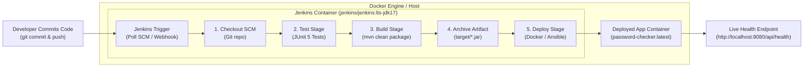

# Jenkins CI/CD Pipeline Implementation Guide
## Automated Build, Test, and Deployment on Git Commit (Docker-Based Jenkins)

**Project:** Password Strength Checker & Improvement Suggestion API  
**Target Repository:** `c:\AnikaDevOpsAssignment\password-checker`  
**Execution Environment:** Containerized Jenkins via Docker Image (`jenkins/jenkins:lts-jdk17`)  
**Pipeline Type:** Declarative Pipeline (`Jenkinsfile`)  

---

## 1. Architecture Overview



---

## 2. Prerequisites

1. **Docker Desktop** installed and running on Windows.
2. **Git** configured and repository initialized (`c:\AnikaDevOpsAssignment\password-checker`).
3. Port `8085` available for Jenkins Web UI (preserving port `8080` for the Spring Boot application).

---

## 3. Phase 1: Run Jenkins Using Docker Images

To allow Jenkins running inside a container to execute Docker commands (build images and deploy containers), we mount the host Docker socket (`docker.sock`).

### Method 1: Single `docker run` Command (Quick Start)

Run this command in PowerShell:

```powershell
# 1. Create a persistent named volume for Jenkins data
docker volume create jenkins_home

# 2. Run the official Jenkins LTS JDK 17 container
docker run -d `
  --name jenkins `
  --restart unless-stopped `
  -p 8085:8080 `
  -p 50000:50000 `
  -v jenkins_home:/var/jenkins_home `
  -v //var/run/docker.sock:/var/run/docker.sock `
  -u root `
  jenkins/jenkins:lts-jdk17
```

> **Why `-u root` and `-v //var/run/docker.sock`?**  
> This allows the Jenkins container to communicate with Docker Desktop on the host so Jenkins pipeline stages can run `docker build` and `docker run` to deploy the application container.

---

### Method 2: Custom Jenkins Dockerfile with Docker CLI & Ansible (Production-Grade)

If you want the Jenkins image to have the Docker CLI and Ansible pre-installed inside the container:

1. Create a `Dockerfile.jenkins` in `c:\AnikaDevOpsAssignment\`:
```dockerfile
FROM jenkins/jenkins:lts-jdk17

USER root

# Install Docker CLI, Ansible, and Maven utilities
RUN apt-get update && apt-get install -y \
    apt-transport-https \
    ca-certificates \
    curl \
    gnupg \
    lsb-release \
    ansible \
    python3-pip \
    && mkdir -p /etc/apt/keyrings \
    && curl -fsSL https://download.docker.com/linux/debian/gpg | gpg --dearmor -o /etc/apt/keyrings/docker.gpg \
    && echo "deb [arch=$(dpkg --print-architecture) signed-by=/etc/apt/keyrings/docker.gpg] https://download.docker.com/linux/debian $(lsb_release -cs) stable" | tee /etc/apt/sources.list.d/docker.list > /dev/null \
    && apt-get update \
    && apt-get install -y docker-ce-cli \
    && rm -rf /var/lib/apt/lists/*

USER jenkins
```

2. Build and run the custom Jenkins image:
```powershell
docker build -t custom-jenkins:lts -f Dockerfile.jenkins .

docker run -d `
  --name jenkins `
  --restart unless-stopped `
  -p 8085:8080 `
  -p 50000:50000 `
  -v jenkins_home:/var/jenkins_home `
  -v //var/run/docker.sock:/var/run/docker.sock `
  --group-add 0 `
  custom-jenkins:lts
```

---

## 4. Phase 2: Retrieve Jenkins Unlock Password & First-Time Setup

1. Check container logs to get the initial administrator password:
   ```powershell
   docker logs jenkins
   ```
   *Look for the 32-character alphanumeric key:*
   ```text
   Please use the following password to proceed to installation:
   4a89f928e12d4d98939cbb87a6f7b1e4
   ```

2. Open your browser and navigate to:
   ```
   http://localhost:8085
   ```

3. Paste the administrator password and click **Continue**.
4. Click **Install Suggested Plugins**.
5. Create your primary Admin User (e.g. `admin` / `admin123`) and complete the wizard.

---

## 5. Phase 3: Configure Global Tools in Jenkins

1. Go to **Manage Jenkins** $\rightarrow$ **Tools**.
2. **JDK Installations:**
   - Click **Add JDK**.
   - Name: `JDK-17`
   - Select **Install automatically** $\rightarrow$ *Extract *.zip/*.tar.gz* or configure Java 17 path.
3. **Maven Installations:**
   - Click **Add Maven**.
   - Name: `Maven-3.9.6`
   - Check **Install automatically** $\rightarrow$ Version: `3.9.6` (or latest 3.9.x).
4. Click **Save**.

---

## 6. Phase 4: Declarative `Jenkinsfile` with Deploy Stage

Ensure your `Jenkinsfile` in `password-checker/Jenkinsfile` contains the **Deploy** stage:

```groovy
pipeline {
    agent any

    tools {
        maven 'Maven-3.9.6'
        jdk 'JDK-17'
    }

    triggers {
        // Automatically check for new commits every 2 minutes
        pollSCM('H/2 * * * *')
    }

    options {
        buildDiscarder(logRotator(numToKeepStr: '10'))
        disableConcurrentBuilds()
        timeout(time: 15, unit: 'MINUTES')
        timestamps()
    }

    environment {
        APP_NAME = 'password-checker'
        IMAGE_NAME = 'password-checker:latest'
        CONTAINER_NAME = 'password-checker-app'
    }

    stages {
        stage('Checkout') {
            steps {
                echo 'Checking out source code from SCM...'
                checkout scm
            }
        }

        stage('Test') {
            steps {
                echo '=================================================='
                echo 'CI Enhancement: Running Automated JUnit 5 Unit Tests'
                echo '=================================================='
                sh 'mvn test'
            }
            post {
                always {
                    junit allowEmptyResults: true, testResults: '**/target/surefire-reports/*.xml'
                }
            }
        }

        stage('Build') {
            steps {
                echo '=================================================='
                echo 'Building Executable JAR'
                echo '=================================================='
                sh 'mvn -DskipTests clean package'
            }
        }

        stage('Archive Artifact') {
            steps {
                echo '=================================================='
                echo 'Archiving Built JAR Artifact'
                echo '=================================================='
                archiveArtifacts artifacts: 'target/*.jar', fingerprint: true, allowEmptyArchive: false
            }
        }

        stage('Deploy') {
            steps {
                echo '=================================================='
                echo 'CD Stage: Deploying Application via Docker Container'
                echo '=================================================='
                script {
                    // Build application Docker image using mounted Docker socket
                    sh "docker build -t ${IMAGE_NAME} ."

                    // Stop and remove older container instance if running
                    sh "docker stop ${CONTAINER_NAME} || true"
                    sh "docker rm ${CONTAINER_NAME} || true"

                    // Launch updated container
                    sh "docker run -d -p 8080:8080 --name ${CONTAINER_NAME} ${IMAGE_NAME}"
                }
            }
        }
    }

    post {
        success {
            echo "SUCCESS: Pipeline completed! ${APP_NAME} is deployed and running on port 8080."
        }
        failure {
            echo "FAILURE: Build or deployment failed! Check console output for details."
        }
    }
}
```

---

## 7. Phase 5: Create the Pipeline Job & Configure Triggers

1. In Jenkins Dashboard, click **New Item**.
2. Name: `password-checker-pipeline` $\rightarrow$ Select **Pipeline** $\rightarrow$ Click **OK**.
3. Under **Build Triggers**:
   - Check **Poll SCM** with schedule: `H/2 * * * *`  
     *(Jenkins will query your repository every 2 minutes and trigger when a new commit hash is found).*
   - *(Optional if public URL available)* Check **GitHub hook trigger for GITScm polling**.
4. Under **Pipeline**:
   - **Definition:** `Pipeline script from SCM`
   - **SCM:** `Git`
   - **Repository URL:** Your GitHub repo URL (e.g. from `repo_link.txt`)
   - **Branch Specifier:** `*/main`
   - **Script Path:** `Jenkinsfile`
5. Click **Save**.

---

## 8. Phase 6: Verify Automatic Deployment on Commit

1. **Initial Baseline Run:**
   - Click **Build Now** in the Jenkins UI.
   - Verify all 5 stages complete with green checkmarks:
     - `Checkout` $\rightarrow$ `Test` $\rightarrow$ `Build` $\rightarrow$ `Archive Artifact` $\rightarrow$ `Deploy`
2. **Commit Test (On-Commit Trigger):**
   - In your repository, push a commit:
     ```bash
     git commit --allow-empty -m "ci: test automated deploy on commit via docker jenkins"
     git push origin main
     ```
   - Within 2 minutes, Jenkins automatically detects the commit and kicks off the build.
3. **Verify Deployed Container:**
   - In PowerShell:
     ```powershell
     docker ps --filter "name=password-checker-app"
     ```
   - Query the application health endpoint:
     ```bash
     curl http://localhost:8080/api/health
     ```
   - Swagger documentation: `http://localhost:8080/swagger-ui/index.html`

---

## 9. Docker-Based Troubleshooting Quick Reference

| Issue | Cause | Resolution |
|---|---|---|
| `docker: command not found` | Docker CLI not installed in Jenkins container | Use the custom `Dockerfile.jenkins` in Phase 1 (Method 2) or install `docker-ce-cli` inside the container. |
| `permission denied while connecting to docker.sock` | Jenkins user lacks socket permissions | Run container with `-u root` or pass host docker group: `--group-add 0`. |
| Port conflict on 8080 | Jenkins mapped to host port 8080 | Map Jenkins to host port 8085: `-p 8085:8080`. The Spring Boot app uses host port `8080`. |
| Jenkins container restarts continuously | Volume permissions or memory limit | Inspect logs with `docker logs jenkins`. Ensure Docker Desktop has at least 4 GB RAM allocated. |
